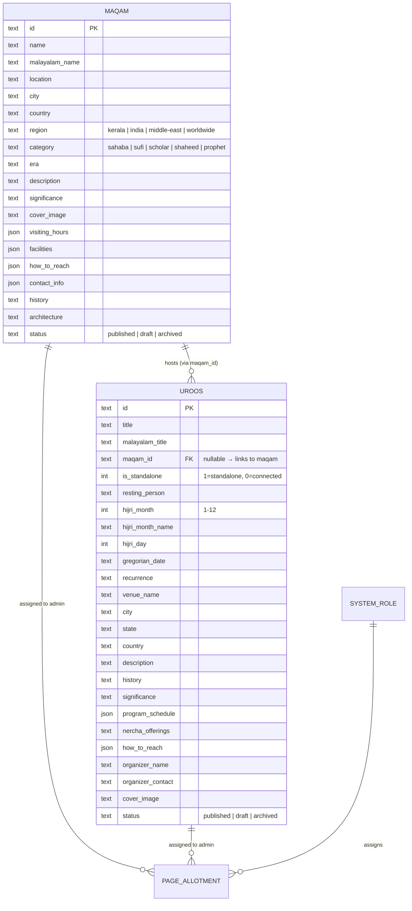
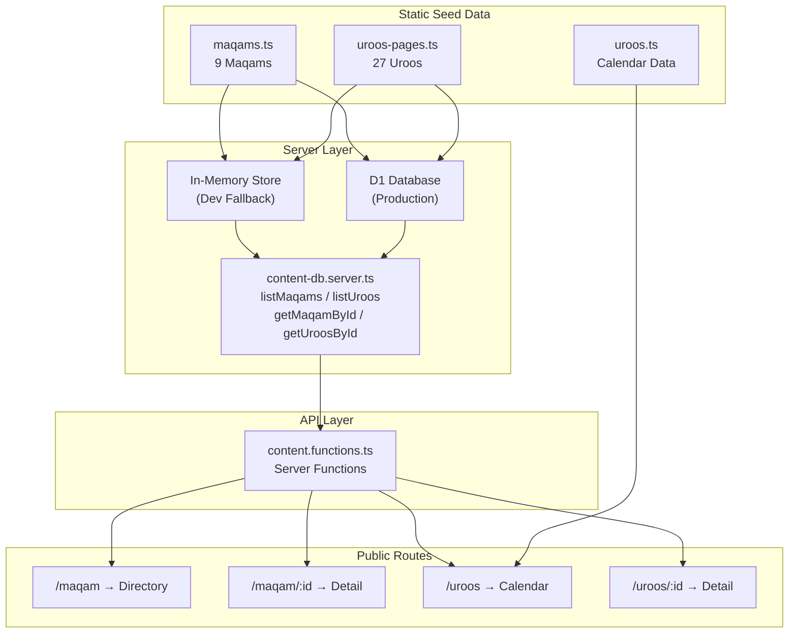

# Maqam & Uroos — Database Architecture & Linking Analysis

## Overview

The Ziyarath project uses a **dual-layer data architecture**: static seed data in TypeScript files (for local dev) with a Cloudflare D1 SQL backend for production. The two main entities — **Maqam** (sacred shrine) and **Uroos** (annual commemoration event) — are linked via a foreign key relationship.

---

## 📊 Entity Relationship

---

## 🔗 Linking System: Maqam ↔ Uroos

### How Linking Works

| Field | Type | Description |
|-------|------|-------------|
| `uroos.maqam_id` | `TEXT (FK)` | References `maqams.id`. If set, the uroos is "connected" to that maqam. |
| `uroos.is_standalone` | `INTEGER` | `1` = standalone event, `0` = hosted at a maqam precinct. |

**Foreign Key:** `FOREIGN KEY (maqam_id) REFERENCES maqams(id) ON DELETE SET NULL`

### Bidirectional Fetching

| Direction | Function | Logic |
|-----------|----------|-------|
| Maqam → Uroos | `getMaqamById(id)` | Fetches maqam, then filters all uroos where `maqam_id === id` → returns `connectedUroos[]` |
| Uroos → Maqam | `getUroosById(id)` | Fetches uroos, then if `maqamId` is set, fetches the connected maqam → returns `connectedMaqam` |

### Currently Linked Entries (5 linked, 22 standalone)

| Uroos ID | Linked Maqam ID | Maqam Exists? |
|----------|-----------------|---------------|
| `mampuram-uroos` | `mampuram` | ✅ Yes |
| `madavoor-uroos` | `madavoor` | ⚠️ **NO** — Missing maqam entry |
| `beemapally-uroos` | `beemapally` | ✅ Yes |
| `ajmer-khwaja-muinuddin-uroos` | `ajmer` | ✅ Yes |
| `kondotty-nercha` | `kondotty` | ✅ Yes |

> [!WARNING]
> **Broken Link:** The uroos `madavoor-uroos` references `maqamId: "madavoor"`, but there is no maqam with `id: "madavoor"` in [`maqams.ts`](file:///c:/Users/hp/Downloads/ziyarath/ziyarath-main/src/data/maqams.ts). This means the "Connected Maqam" card will not render on that uroos detail page.

---

## 📁 Data Layer Files

| File | Purpose | Entries |
|------|---------|---------|
| [`maqams.ts`](file:///c:/Users/hp/Downloads/ziyarath/ziyarath-main/src/data/maqams.ts) | Static seed data for 9 maqams | `MAQAMS: Maqam[]` |
| [`uroos.ts`](file:///c:/Users/hp/Downloads/ziyarath/ziyarath-main/src/data/uroos.ts) | Calendar data — hijri month/day entries with `pageId` links | `UROOS_MONTHS: UroosMonth[]` |
| [`uroos-pages.ts`](file:///c:/Users/hp/Downloads/ziyarath/ziyarath-main/src/data/uroos-pages.ts) | Full dedicated page data for 27 uroos events | `ALL_DEDICATED_UROOS: DbUroos[]` |
| [`content.ts`](file:///c:/Users/hp/Downloads/ziyarath/ziyarath-main/src/types/content.ts) | TypeScript types: `DbMaqam`, `DbUroos`, `PageAllotment`, `SystemUser` |

## 📡 Server Functions Layer

| Function | Method | Source |
|----------|--------|--------|
| `listMaqamsPublicFn` | GET | [`content.functions.ts`](file:///c:/Users/hp/Downloads/ziyarath/ziyarath-main/src/lib/content.functions.ts) |
| `getMaqamPublicDetailFn` | GET | [`content.functions.ts`](file:///c:/Users/hp/Downloads/ziyarath/ziyarath-main/src/lib/content.functions.ts) |
| `listUroosPublicFn` | GET | [`content.functions.ts`](file:///c:/Users/hp/Downloads/ziyarath/ziyarath-main/src/lib/content.functions.ts) |
| `getUroosPublicDetailFn` | GET | [`content.functions.ts`](file:///c:/Users/hp/Downloads/ziyarath/ziyarath-main/src/lib/content.functions.ts) |

## 🗺️ Route Architecture

| Route | File | Description |
|-------|------|-------------|
| `/maqam` | [`maqam.tsx`](file:///c:/Users/hp/Downloads/ziyarath/ziyarath-main/src/routes/maqam.tsx) | Maqam directory listing with search/filter |
| `/maqam/$id` | [`maqam_.$id.tsx`](file:///c:/Users/hp/Downloads/ziyarath/ziyarath-main/src/routes/maqam_.$id.tsx) | Maqam detail page (shows connected uroos) |
| `/uroos` | [`uroos.tsx`](file:///c:/Users/hp/Downloads/ziyarath/ziyarath-main/src/routes/uroos.tsx) | Uroos calendar + featured/grid/timeline views |
| `/uroos/$id` | [`uroos_.$id.tsx`](file:///c:/Users/hp/Downloads/ziyarath/ziyarath-main/src/routes/uroos_.$id.tsx) | Uroos detail page (shows connected maqam link) |

---

## 🔄 Data Flow Diagram

---

## ⚠️ Issues Found

1. **Missing Maqam:** `madavoor` referenced by `madavoor-uroos` doesn't exist in `maqams.ts`
2. **Calendar → Page Linking:** The `uroos.ts` calendar uses `pageId` to link to `uroos-pages.ts` entries by ID. All 27 calendar entries have matching page entries.
3. **Region field discrepancy:** Maqam uses 4 regions (`kerala | india | middle-east | worldwide`), Uroos uses 3 regions (`kerala | india | worldwide`). Middle-east uroos entries don't exist.
